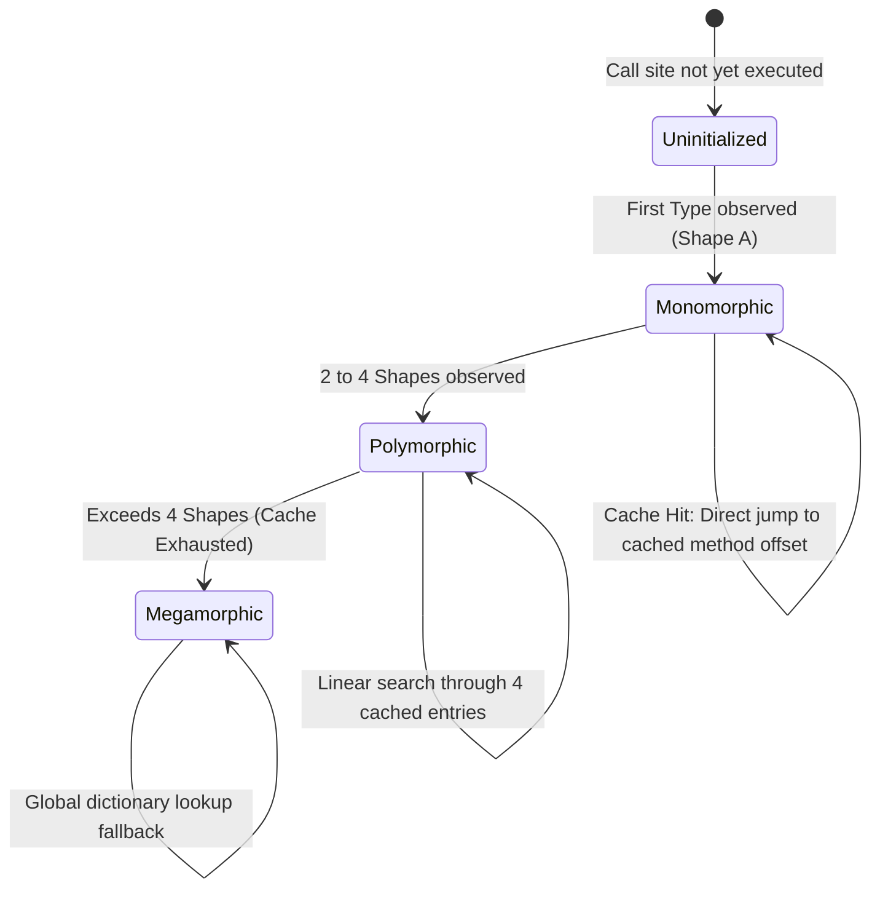

# JIT Compilation: Inline Caching (Monomorphic, Polymorphic, Megamorphic)

Inline Caching (IC) eliminates dynamic method lookup overhead in dynamically typed languages by patching call sites with specialized stubs based on observed object hidden classes (Shapes / Maps).



---

## 1. Inline Cache Call-Site Machine Code

```nasm
# Monomorphic Inline Cache Stub for property read: obj.x
cmp     [rax + 0x00], Shape_A   ; Check object Shape against cached Shape A
jne     .stub_miss              ; Shape mismatch -> Transition to Polymorphic
mov     rax, [rax + 0x10]       ; Direct memory load at hardcoded offset
ret
.stub_miss:
call    __runtime_ic_miss       ; Call runtime to expand IC stub
```

* **Monomorphic:** Observed exactly 1 shape; single check instruction followed by direct field access.
* **Polymorphic:** Observed 2-4 distinct shapes; small unrolled branch table.
* **Megamorphic:** Falls back to global hash table lookups; compiler bails out of speculative inlining.
