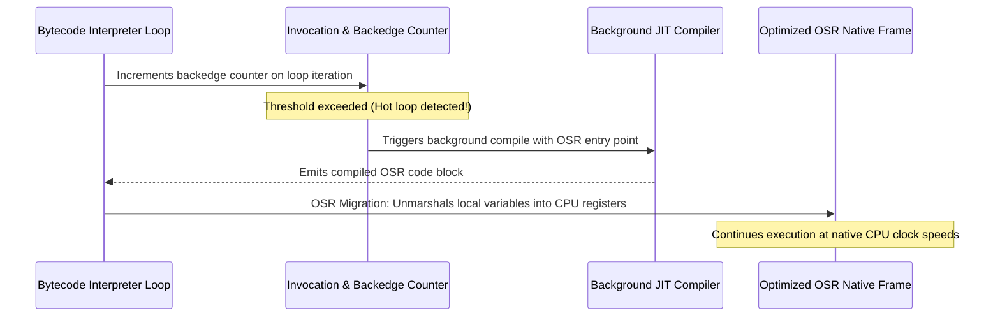

# JIT Compilation: On-Stack Replacement (OSR) Execution Transitions

On-Stack Replacement (OSR) migrates an actively executing long-running loop from slow interpreter bytecode or baseline tiers into highly optimized native machine code mid-execution.

---

## 1. Frame Reconstruction Invariants

1. **State Reconstruction:** The runtime maps interpreter local variables and operand stack slots directly into CPU registers and stack spill slots designated by the JIT compiler's register allocator.
2. **Loop Entry Invariant:** Execution jumps directly to the loop header instruction within the compiled code body rather than the function prologue.
3. **Deoptimization Mirror:** If speculative invariants fail within the loop, the native frame deoptimizes back to interpreter stack frames using opposite metadata unmarshaling.
