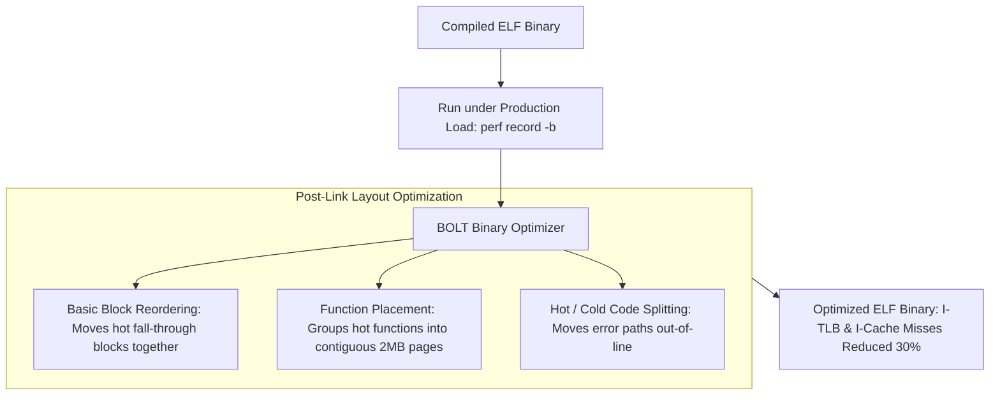

# Compiler Optimization: Post-Link Binary Optimization with BOLT & PGO

Facebook BOLT (Binary Optimization and Layout Tool) analyzes execution sample profiles (Linux `perf`) to reorder basic blocks and functions in compiled ELF binaries, optimizing instruction cache hit rates.

---

## 1. Microarchitectural Impact

1. **Branch Misprediction Reduction:** Hot branches are converted to fall-through layout paths, avoiding branch instructions completely.
2. **I-Cache Efficiency:** Eliminates cold instructions (error handling, debug assertions) from L1 instruction cache lines.
3. **Hugepage Alignment:** Groups all hot functions together into contiguous 2MB memory blocks, slashing Instruction TLB (iTLB) misses.
