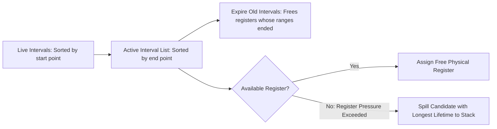

# JIT Compilation: Linear Scan Register Allocation (Poletto & Sarkar)

Linear Scan Register Allocation allocates physical CPU registers in $O(V)$ linear time over live variable intervals, providing JIT compilers with fast code generation compared to graph coloring.

---

## 1. Algorithm Invariants

1. **Sorting:** Live intervals $[start, end]$ are computed via liveness analysis and sorted by ascending $start$ positions.
2. **Active List Maintenance:** Active intervals currently holding registers are maintained sorted by ascending $end$ points.
3. **Spill Heuristic:** When physical registers are exhausted, the allocator compares the current interval against active intervals, spilling the variable that extends farthest into the future (`SpillAtInterval`).
