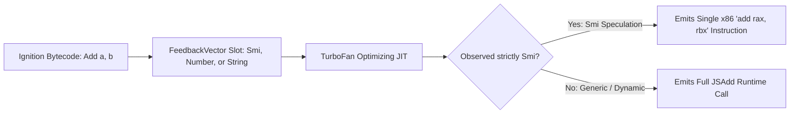

# JIT Compilation: V8 Type Feedback & Speculative Specialization

V8 Ignition and TurboFan record dynamic runtime types in Type Feedback Vectors, allowing optimizing compilers to generate monomorphic machine code specialized for observed operand types.

---

## 1. Feedback Slot Kinds

* **BinaryOp Feedback:** Tracks operand categories (`SignedSmall` / `Smi`, `Number`, `String`, `BigInt`, `Any`).
* **CompareOp Feedback:** Records comparison types to eliminate generic IEEE 754 NaN handling when comparing integer counters.
* **Call Feedback:** Records target JSFunction pointers, enabling direct speculative inlining of hot call sites.
