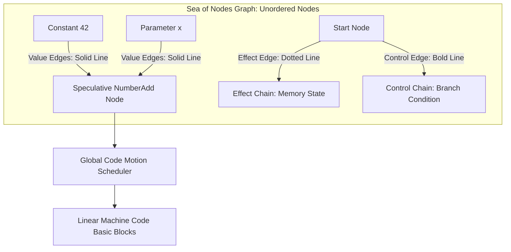

# JIT Compilation: V8 TurboFan Sea-of-Nodes Intermediate Representation

V8 TurboFan represents JavaScript code using a Sea-of-Nodes graph that unifies control-flow, data-flow, and memory effect dependencies into a single relaxed dependency graph.

---

## 1. Edge Typologies

* **Value Edges (Data Flow):** Carry computed values between nodes without imposing execution sequence constraints.
* **Effect Edges (Memory Flow):** Order mutable memory loads and stores to preserve program semantics without forcing arbitrary non-aliasing instructions into fixed execution orders.
* **Control Edges (Execution Flow):** Explicitly enforce branch divergence (`Branch`, `IfTrue`, `IfFalse`, `Merge`, `Loop`).
* **Late Scheduling:** Nodes float freely until the final instruction scheduling pass binds them into basic blocks based on dominator trees and register pressure models.
