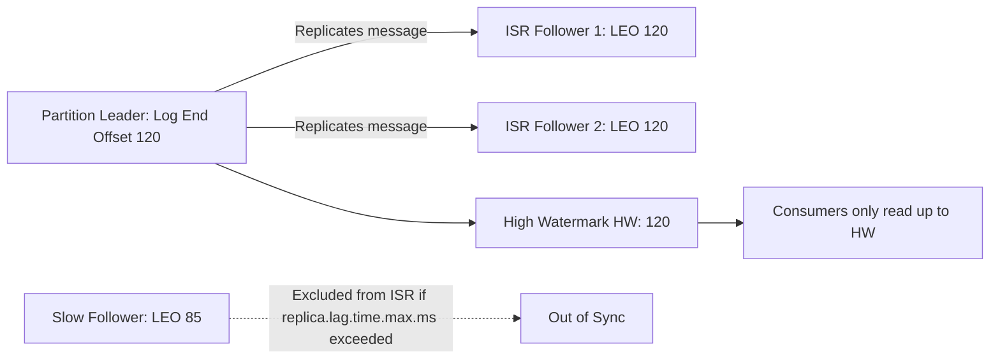

# Apache Kafka: In-Sync Replicas (ISR) & High Watermark Architecture

Kafka replicates partition logs across an in-sync replica (ISR) set. The High Watermark (HW) marks the offset boundary visible to consumers, while producer acknowledgments and replica configuration determine when a write is reported successful. Replication improves fault tolerance, but does not guarantee zero message loss under every configuration or failure.

---

## 1. High Watermark Invariants

* **Log End Offset (LEO):** Offset of the next record to be written in a partition log.
* **High Watermark (HW):** Minimum LEO among all current ISR members; dictates the boundary of committed data visible to consumers.

---

## 2. Durability depends on producer and topic settings

For stronger write durability, use producer cks=all with a deliberate min.insync.replicas value. cks=all waits for all replicas currently in the ISR; min.insync.replicas makes the write fail when the ISR falls below the configured minimum. For example, with replication factor 3 and min.insync.replicas=2, a write can still succeed with two in-sync replicas, but the producer receives an error if fewer than two remain. These settings improve the guarantee; they do not replace backups or protect against every correlated failure.

## References

- Apache Kafka, [Topic-level configuration: min.insync.replicas](https://kafka.apache.org/44/configuration/topic-configs/#topicconfigs_min.insync.replicas).
