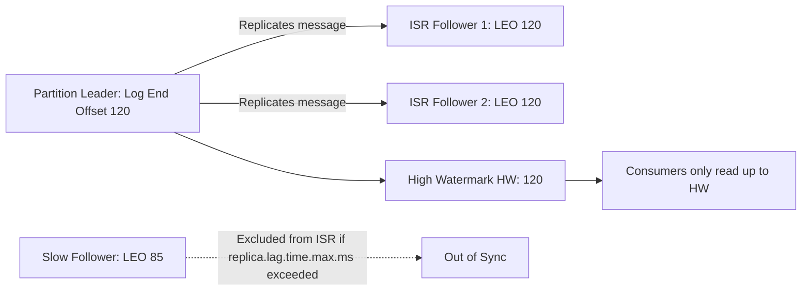

# Apache Kafka: In-Sync Replicas (ISR) & High Watermark Architecture

Kafka guarantees zero message loss through partitioned commit logs coordinated by an in-sync replica (ISR) set, exposing messages to consumers only when they advance past the High Watermark (HW).

---

## 1. High Watermark Invariants

* **Log End Offset (LEO):** Offset of the next record to be written in a partition log.
* **High Watermark (HW):** Minimum LEO among all current ISR members; dictates the boundary of committed data visible to consumers.
