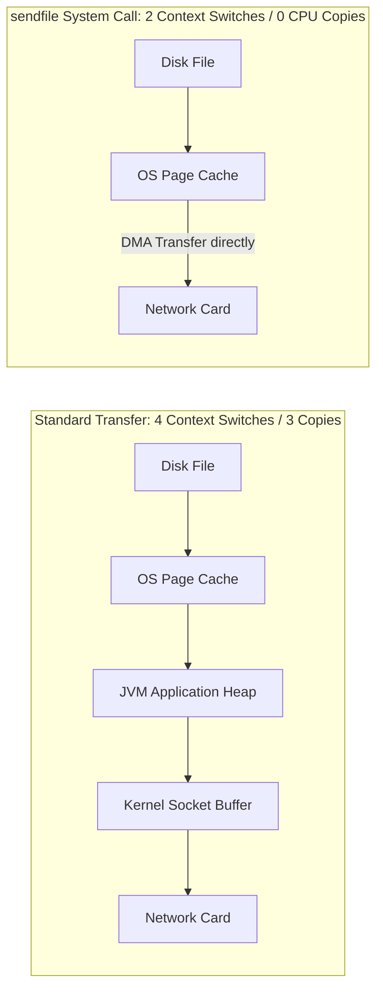

# Apache Kafka: Zero-Copy Sendfile & KRaft Quorum

Kafka delivers multi-gigabit throughput by routing network streams directly through the OS kernel and replacing ZooKeeper with an integrated Raft-based metadata quorum (KRaft).

---

## 1. Engine Highlights

1. **Linux `sendfile()`:** Data moves directly from kernel page cache buffers to the network interface card via DMA, bypassing JVM heap allocations.
2. **KRaft Metadata Quorum:** Uses an event-driven Raft protocol inside Kafka brokers to eliminate ZooKeeper latency spikes and speed up cluster recovery.
