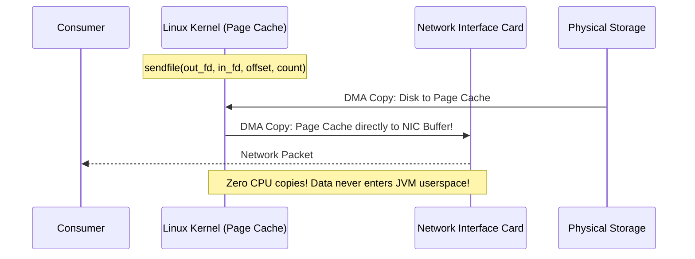

# Streaming Systems: Apache Kafka Zero-Copy sendfile() Architecture

Kafka avoids JVM memory heap overhead for message storage, relying entirely on the Linux kernel Page Cache and the `sendfile()` zero-copy system call.

---

## 1. Memory Invariance
Kafka runs comfortably with small JVM heaps (e.g. 6-8 GB) while utilizing 64-128 GB of host RAM as Linux Page Cache.
