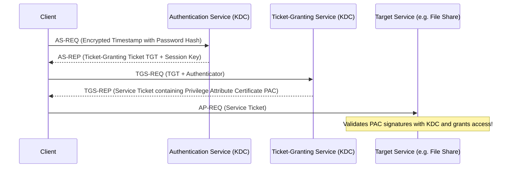

# Authentication Architecture: Kerberos v5 and Active Directory PAC

Kerberos authenticates users across enterprise networks without transmitting passwords over the wire, utilizing symmetric key cryptography and short-lived tickets.

---

## 1. PAC Validation
The Privilege Attribute Certificate (PAC) contains user security identifiers (SIDs) and group memberships, cryptographically signed by the KDC to prevent privilege escalation.
