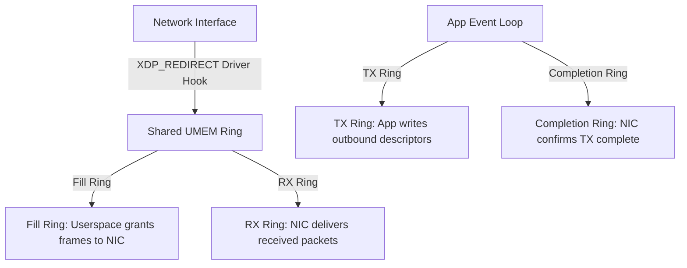

# AF_XDP (XSK) Zero-Copy Network Ingress Architecture

AF_XDP (Address Family XDP) transmits raw Ethernet frames into userspace via memory-mapped ring buffers, bypassing the `sk_buff` allocation path.



---

## 1. Four Ring Buffer Architecture

AF_XDP uses four separate circular lock-free single-producer single-consumer ring buffers:

1. **Fill Ring (Userspace $\to$ Kernel)**: Passes available buffer addresses from UMEM to the driver for incoming packets.
2. **RX Ring (Kernel $\to$ Userspace)**: Contains descriptors of received packets with buffer offsets and lengths.
3. **TX Ring (Userspace $\to$ Kernel)**: Houses packets queued for transmission by the application.
4. **Completion Ring (Kernel $\to$ Userspace)**: Returns transmitted buffer descriptors back to userspace for reuse.

---

## 2. eBPF Redirect Program

```c
#include <linux/bpf.h>
#include <bpf/bpf_helpers.h>

struct {
    __uint(type, BPF_MAP_TYPE_XSKMAP);
    __uint(max_entries, 64);
    __type(key, int);
    __type(value, int);
} xsk_map SEC(".maps");

SEC("xdp")
int xdp_sock_prog(struct xdp_md *ctx) {
    int index = ctx->rx_queue_index;
    // Direct packet into AF_XDP socket mapped to this queue
    return bpf_redirect_map(&xsk_map, index, XDP_PASS);
}

char _license[] SEC("license") = "GPL";
```
