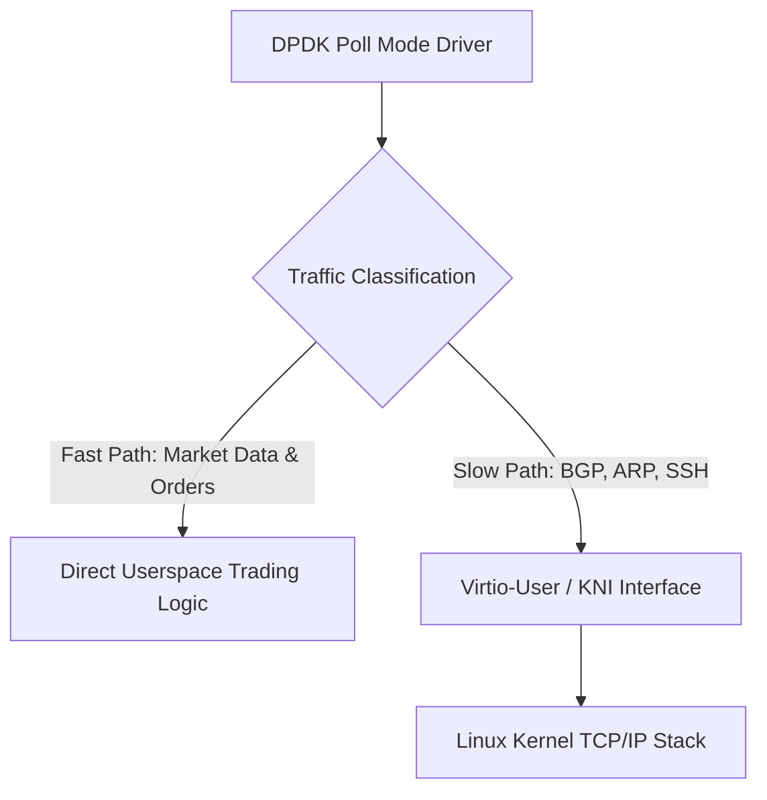

# DPDK KNI vs. Virtio-User Architecture

Comparison of kernel-NIC interface alternatives for routing control traffic back into the Linux networking stack.

---

## 1. Architectural Trade-offs

| Feature | DPDK KNI (Deprecated) | Virtio-User + vhost-kernel |
|---|---|---|
| Kernel Dependency | Out-of-tree kernel module required | Standard upstream Linux `vhost_net` |
| Performance | High CPU usage in kernel thread | Zero-copy descriptor ring via vhost |
| Security | Bypasses kernel boundary checks | Operates within standard tap/tun security boundaries |
| Upstream Status | Deprecated in DPDK 22.11 | Active standard recommendation |
