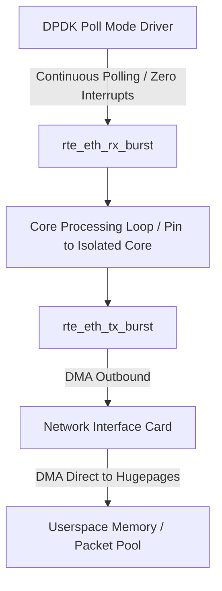

# Kernel Bypass with DPDK Poll Mode Drivers (PMD)

The Data Plane Development Kit (DPDK) moves packet processing entirely into userspace, eliminating OS kernel overhead, context switches, and interrupt handling.



---

## 1. Traditional Socket Path vs. DPDK PMD

| Architectural Component | Linux Kernel Network Stack | DPDK Userspace PMD |
|---|---|---|
| Ingress Notification | Hardware IRQ $\to$ SoftIRQ $\to$ epoll | Continuous polling via `rte_eth_rx_burst()` |
| Memory Allocation | `sk_buff` allocation per packet | Preallocated `rte_mempool` with hugepages |
| Data Copying | NIC DMA $\to$ Kernel Ring $\to$ Userspace buffer | Direct DMA to userspace hugepage memory pool |
| Context Switches | 2 switches per I/O call (`syscall` entry/exit) | 0 context switches (dedicated pinned core) |
| Latency Profile | 1.5 µs - 15 µs (high jitter) | 80 ns - 250 ns (deterministic) |

---

## 2. Core PMD Packet Reception Loop

```c
#include <rte_eal.h>
#include <rte_ethdev.h>
#include <rte_mbuf.h>

#define BURST_SIZE 32
#define MEMPOOL_CACHE_SIZE 256
#define NUM_MBUFS 8191

void run_fast_rx_loop(uint16_t port_id, uint16_t queue_id) {
    struct rte_mbuf *rx_pkts[BURST_SIZE];
    
    while (1) {
        // Poll RX ring buffer directly with zero syscalls
        uint16_t nb_rx = rte_eth_rx_burst(port_id, queue_id, rx_pkts, BURST_SIZE);
        if (nb_rx == 0) {
            continue;
        }

        for (uint16_t i = 0; i < nb_rx; i++) {
            struct rte_mbuf *m = rx_pkts[i];
            uint8_t *packet_data = rte_pktmbuf_mtod(m, uint8_t *);
            uint32_t packet_len = rte_pktmbuf_pkt_len(m);

            // Execute zero-copy parsing
            process_market_tick(packet_data, packet_len);

            // Free packet back to userspace mempool
            rte_pktmbuf_free(m);
        }
    }
}
```

---

## 3. Hugepages and UIO/VFIO Binding

DPDK requires physically contiguous memory blocks to map DMA addresses directly for NIC hardware.

```bash
# Reserve 1024 2MB hugepages (2GB total)
echo 1024 | sudo tee /sys/kernel/mm/hugepages/hugepages-2048kB/nr_hugepages

# Bind physical NIC to VFIO driver
sudo modprobe vfio-pci
sudo dpdk-devbind.py --bind=vfio-pci 0000:03:00.0
```
