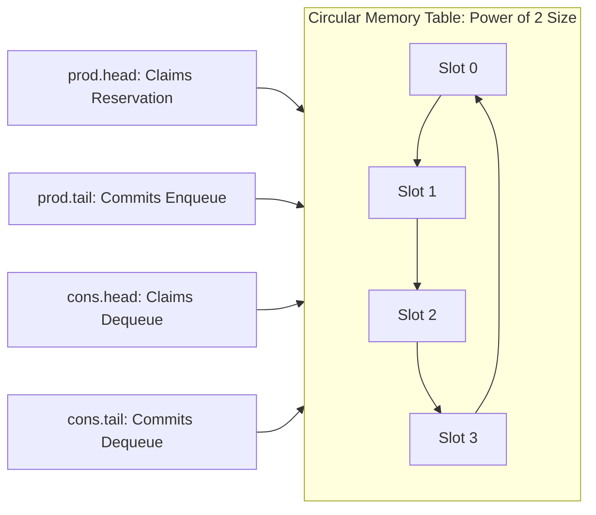

# DPDK: rte_ring Lockless Memory Ring Buffer Internals

The DPDK `rte_ring` provides high-throughput lockless Multi-Producer Multi-Consumer (MPMC) FIFO queues based on memory barriers and Compare-And-Swap (CAS) sequence indexing.

---

## 1. MPMC Enqueue Protocol

1. **Reservation Phase:** Producer threads read `prod.head`, compute `prod_next = prod_head + n`, and execute an atomic CAS (`atomic_compare_exchange_weak`).
2. **Buffer Write Phase:** Successful threads write payload pointers into the table without lock contention.
3. **Commit Phase:** Threads wait until `prod.tail == prod_head` before updating `prod.tail = prod_next`, guaranteeing strict FIFO visibility for consumers.
