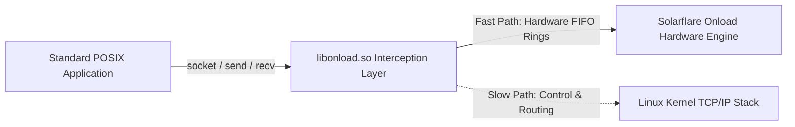

# Solarflare OpenOnload & Kernel Bypass Architecture

OpenOnload intercepts BSD socket API calls in userspace to achieve direct NIC hardware interaction while maintaining standard POSIX socket compatibility.



---

## 1. Hardware Virtual Interfaces (VI)

Solarflare NICs implement physical Virtual Interfaces (VIs) directly on silicon:

- **TX/RX Ring Buffers**: Pinned directly in application address space.
- **Event Queues**: Deliver completion notices to userspace without interrupts.
- **Doorbell Registers**: MMIO memory-mapped write registers that instruct the NIC to fetch outbound descriptors immediately.

---

## 2. Low-Latency Deployment Configuration

To maximize throughput and minimize p99 latency:

```bash
# Launch application with OpenOnload acceleration
onload --profile=latency \
       --env EF_POLL_USEC=-1 \
       --env EF_SPIN_USEC=-1 \
       --env EF_VI_RX_RING_SIZE=2048 \
       ./trading_gateway
```

Key environment configurations:
- `EF_POLL_USEC=-1`: Infinite busy-polling mode; completely suppresses hardware interrupts.
- `EF_SPIN_USEC=-1`: Spins continuously on lock acquisition rather than invoking `futex()`.
- `EF_RXQ_LIMIT`: Adjusts ring capacity to prevent packet drops under microbursts.
