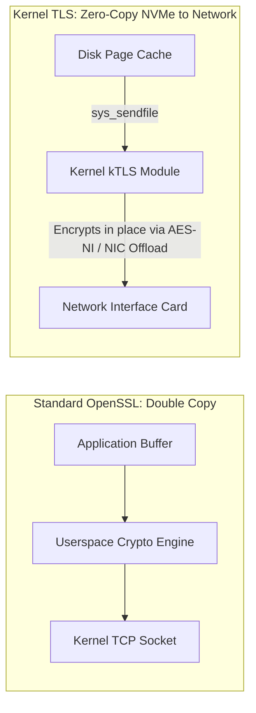

# Kernel TLS (kTLS): Zero-Copy Splicing & Inline NIC Offload

Kernel TLS (kTLS) moves symmetric cryptographic framing (AES-GCM / ChaCha20-Poly1305) into the Linux kernel TCP stack, enabling zero-copy `sendfile()` over encrypted sessions.

---

## 1. Socket Configuration

* **Socket Option:** Configured via `setsockopt(fd, SOL_TLS, TLS_TX, &crypto_info, sizeof(crypto_info))` after user-space handshake completion.
* **SmartNIC Offload:** Compatible NICs (Mellanox ConnectX-6+) perform hardware encryption directly on the wire without consuming CPU cycles.
