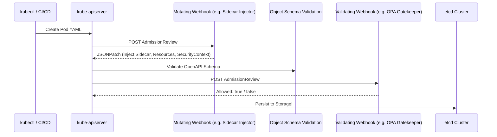

# Kubernetes Security: Dynamic Admission Controller Webhook Pipeline

Admission webhooks intercept requests to the `kube-apiserver` before objects are persisted to etcd.

---

## 1. Execution Order Invariant
Mutating webhooks ALWAYS run before Validating webhooks so that policies can audit the final, fully-mutated state of the object.
