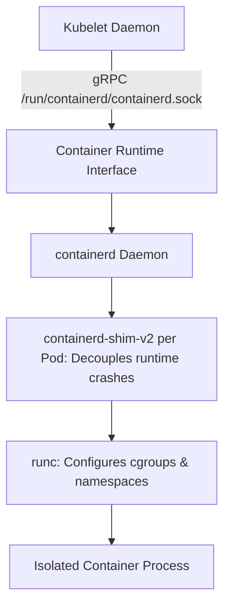

# Container Runtimes: containerd vs CRI-O Architecture

Both containerd and CRI-O implement the Kubernetes Container Runtime Interface (CRI), utilizing `runc` or `crun` to spawn OCI-compliant isolated processes.

---

## 1. Shim v2 Decoupling
The shim process stays alive alongside the container:
- Retains container stdin/stdout pipes and exit code.
- Allows the host containerd daemon to restart/upgrade without terminating active running containers.
