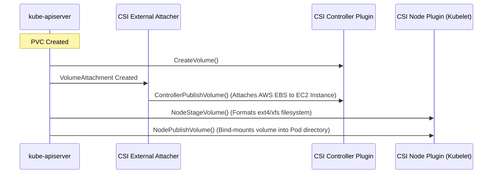

# Kubernetes Storage: CSI Volume Lifecycle (Provision, Attach, Mount)

The Container Storage Interface (CSI) decouples block and file storage providers from the in-tree Kubernetes codebase.

---

## 1. NodeStage vs NodePublish
- **NodeStageVolume:** Executed once per node (formats block device and mounts to global staging path).
- **NodePublishVolume:** Executed per pod (bind-mounts from staging directory into container namespace).
