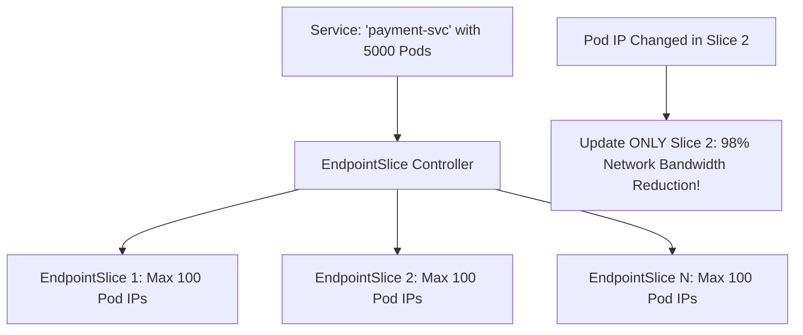

# Kubernetes Control Plane: EndpointSlice API Architecture

The legacy `Endpoints` resource stored all pod IPs for a Service in a single object. For a service with 5,000 pods, a single pod update triggered full serialization of the entire 1.5MB object.

---

## 1. Architectural Limit
Each `EndpointSlice` holds at most 100 endpoints by default, eliminating etcd write amplification and kube-proxy serialization bottlenecks.
