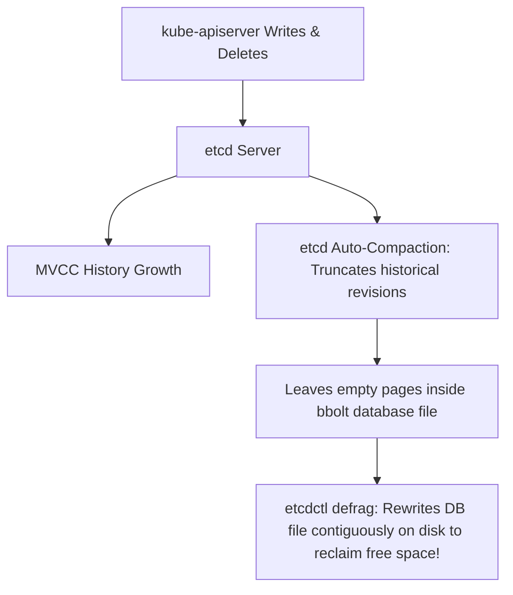

# Kubernetes Reliability: etcd MVCC Compaction and Disk Defragmentation

etcd utilizes Raft for consensus and a B+ Tree (bbolt) on disk for MVCC key-value storage. Deleting Kubernetes objects leaves fragmentation in bbolt db files.

---

## 1. Alarm Mitigation
If etcd database exceeds `--quota-backend-bytes` (default 2GB, recommended 8GB), etcd sets `NOSPACE` alarm, turning entire cluster read-only until compacted and defragged.
