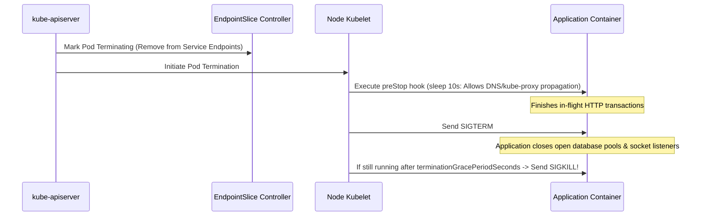

# Production Reliability: Pod Termination Lifecycle and preStop Hooks

Terminating pods without dropping in-flight client requests requires orchestrating endpoint removal concurrently with application graceful shutdown.

---

## 1. Race Condition Fix
Without a `preStop: exec: command: ["sleep", "10"]`, the pod receives SIGTERM before iptables/IPVS rules remove its IP from upstream load balancers, causing 502 Bad Gateway errors.
