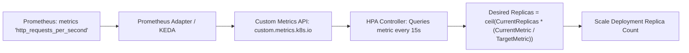

# Kubernetes Autoscaling: Horizontal Pod Autoscaler (HPA) Custom Metrics

HPA scales pod replicas dynamically based on CPU/Memory or custom business metrics (e.g. SQS queue length, HTTP requests/second).

---

## 1. Stabilization Window
The `behavior.scaleDown.stabilizationWindowSeconds` (default 300s) prevents flapping (rapid scaling up and down) during bursty traffic patterns.
