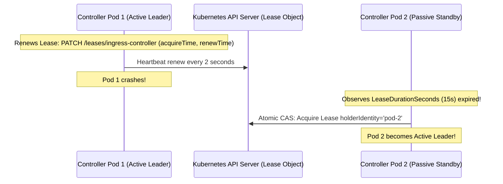

# High Availability: Kubernetes Leader Election with Coordination Leases

Kubernetes controllers (kube-controller-manager, cert-manager, ingress controllers) coordinate active-passive failover using the `coordination.k8s.io/v1` Leases API.

---

## 1. Split-Brain Prevention
Uses resourceVersion optimistic concurrency control on the Lease object. If two pods attempt to renew simultaneously, the slower CAS operation fails with a 409 Conflict.
