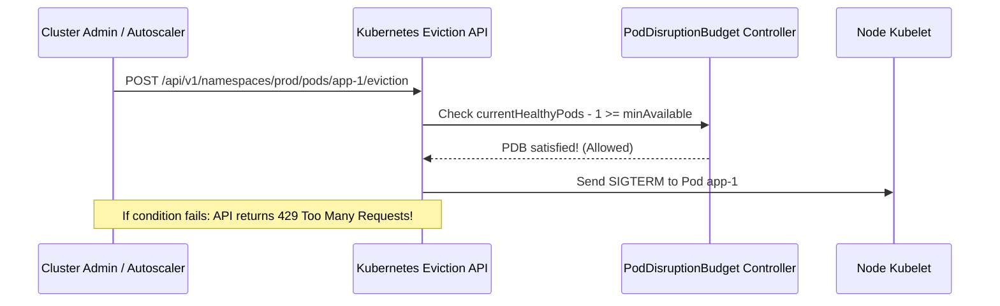

# Kubernetes Operations: PodDisruptionBudget and Eviction API

PDBs guarantee application availability during voluntary disruptions (e.g., node drains for AMI updates or cluster upgrades).

---

## 1. Specification Rules
- `minAvailable: 80%` or `maxUnavailable: 1`
- Only applies to voluntary disruptions (`kubectl drain`), not hardware crashes or node kernel panics.
