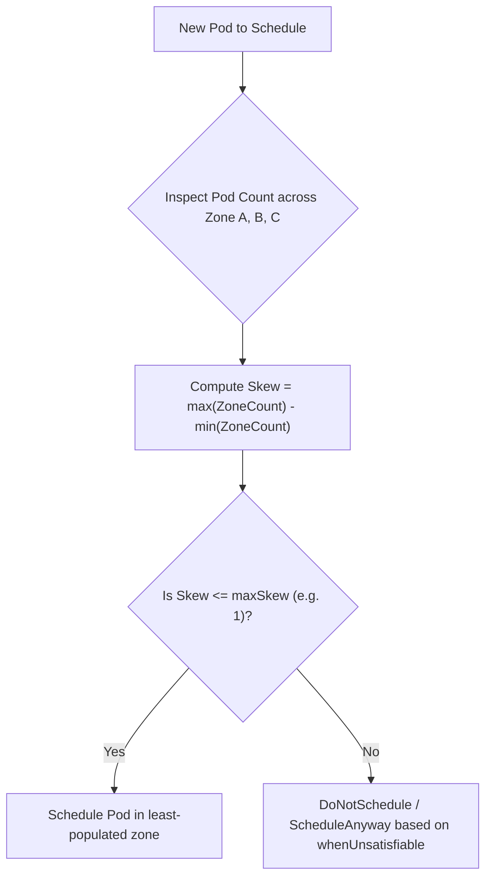

# Kubernetes Scheduling: Topology Spread Constraints Architecture

Topology Spread Constraints ensure pods are evenly distributed across failure domains (zones, regions, nodes) to prevent localized outages.

---

## 1. Invariant
Enforces high availability without hard anti-affinity anti-patterns that prevent autoscaling.
