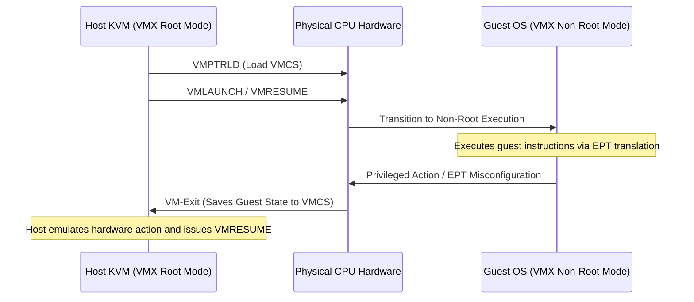

# KVM: Hardware Virtualization (VMX) & Extended Page Tables (EPT)

Intel VMX (Virtual Machine Extensions) and AMD-V enable bare-metal virtualization by switching CPU contexts between root mode (host kernel) and non-root mode (guest VM).

---

## 1. Extended Page Tables (EPT)

* **Two-Dimensional Walk:** Guest Virtual Addresses (GVA) translate to Guest Physical Addresses (GPA) via guest CR3, which then translate to Host Physical Addresses (HPA) via hardware EPT pointers.
* **VMCS Structure:** The Virtual Machine Control Structure records host state, guest state, VM-execution controls, and VM-exit reasons.
