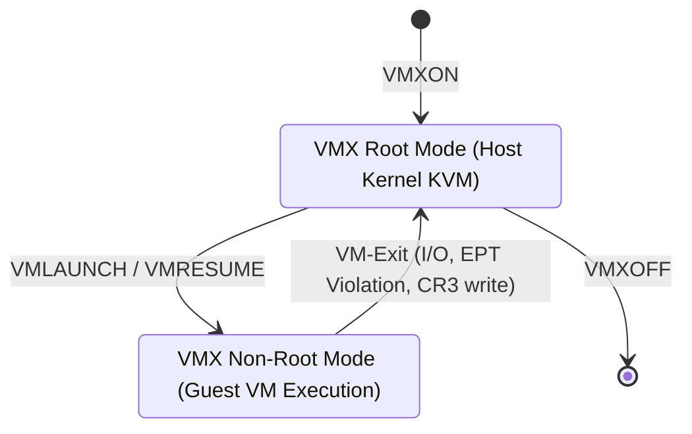

# KVM & Intel VMX Hardware-Assisted Virtualization

Intel VT-x (VMX) introduces root and non-root CPU operating modes. The kernel controls guests through the Virtual Machine Control Structure (VMCS), executing guest instructions natively until intercepted operations trigger a VM-Exit.

---

## 1. VMCS Control Areas

* **Guest-State Area:** Processor register snapshots loaded on VM-Entry.
* **Host-State Area:** Kernel state restored automatically on VM-Exit.
* **VM-Execution Control Fields:** Determines which instructions trigger traps (e.g. `INVD`, `CR3` load, `MSR` access).
* **VM-Exit Information Fields:** Exposes exit reason, qualification register values, and fault addresses.
