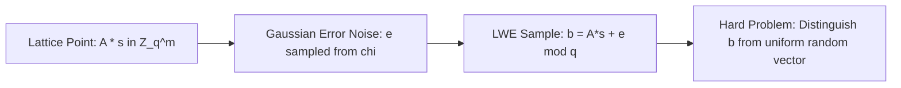

# Lattice Cryptography & Learning With Errors (LWE)

The Learning With Errors problem and its ring variant (Ring-LWE) form the mathematical foundation for post-quantum public-key encryption, digital signatures, and homomorphic encryption.

---

## 1. Search vs Decision LWE

* **Search-LWE:** Given $(\mathbf{A}, \mathbf{b} = \mathbf{A}\mathbf{s} + \mathbf{e} mod q)$, recover secret vector $\mathbf{s} \in \mathbb{Z}_q^n$.
* **Decision-LWE:** Distinguish pairs $(\mathbf{A}, \mathbf{A}\mathbf{s} + \mathbf{e})$ from uniformly random pairs $(\mathbf{A}, \mathbf{u}) \in \mathbb{Z}_q^{m 	imes n} 	imes \mathbb{Z}_q^m$.
* **Worst-Case to Average-Case Reduction:** Solving average-case LWE is at least as hard as quantumly approximating Shortest Vector Problem (SVP) and Shortest Independent Vectors Problem (SIVP) on arbitrary lattices within polynomial factors.
