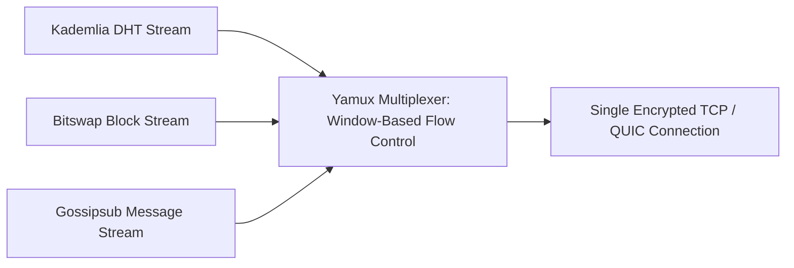

# Peer-to-Peer Networking: libp2p Yamux Stream Multiplexer

libp2p utilizes stream multiplexers to open arbitrary bidirectional channels over a single secure connection (Noise/TLS).

---

## 1. Yamux vs mplex
- **mplex:** Minimal framing without flow control; prone to buffer overflows on heterogeneous peers.
- **Yamux (Yet Another Multiplexer):** RFC-grade window-based flow control preventing slow readers from stalling the transport connection.
