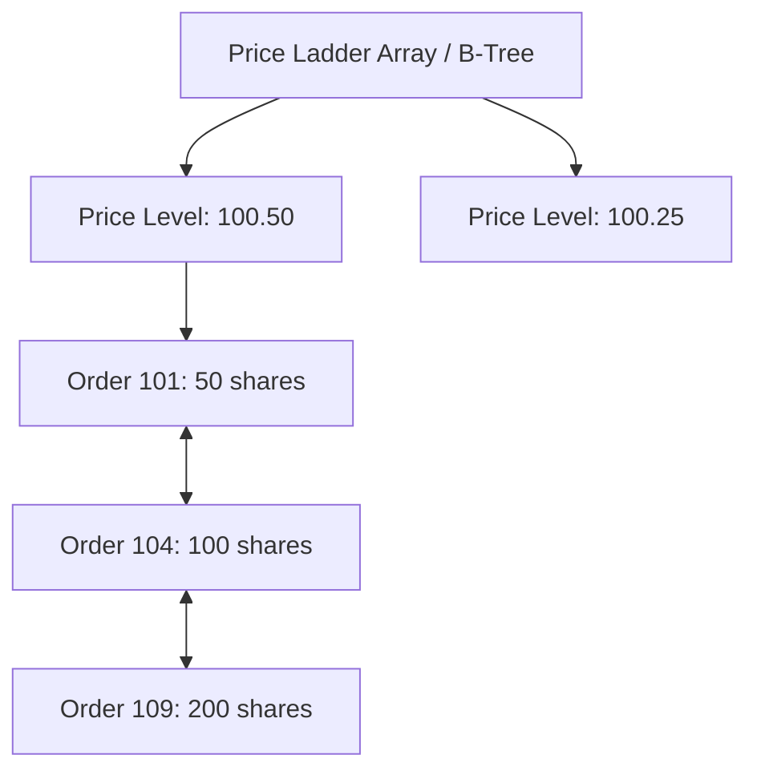

# Limit Order Book Matching Engine Architecture

High-throughput limit order books organize active orders across price levels using doubly-linked lists and sparse price index tables to guarantee $O(1)$ operations.



---

## 1. Algorithmic Complexity Guarantees

| Operation | Array / Price Map | Doubly-Linked List at Level | Combined LOB Complexity |
|---|---|---|---|
| **Add Order** | $O(1)$ direct array index | $O(1)$ append to tail | $O(1)$ |
| **Cancel Order** | $O(1)$ hash map lookup | $O(1)$ node pointer removal | $O(1)$ |
| **Match Order** | $O(1)$ best bid/ask pointer | $O(1)$ pop from head | $O(1)$ |

---

## 2. Intrusive Linked List Order Structure

To avoid dynamic allocations when linking orders into queues:

```cpp
#include <cstdint>

struct LimitOrder {
    uint64_t order_id;
    int64_t price;
    uint32_t quantity;
    char side;

    LimitOrder* prev = nullptr;
    LimitOrder* next = nullptr;
};

struct PriceLevel {
    int64_t price;
    uint32_t total_volume = 0;
    uint32_t order_count = 0;
    LimitOrder* head = nullptr;
    LimitOrder* tail = nullptr;

    void append(LimitOrder* order) {
        order->prev = tail;
        order->next = nullptr;
        if (tail) tail->next = order;
        else head = order;
        tail = order;
        total_volume += order->quantity;
        order_count++;
    }

    void remove(LimitOrder* order) {
        if (order->prev) order->prev->next = order->next;
        else head = order->next;
        if (order->next) order->next->prev = order->prev;
        else tail = order->prev;
        total_volume -= order->quantity;
        order_count--;
    }
};
```
