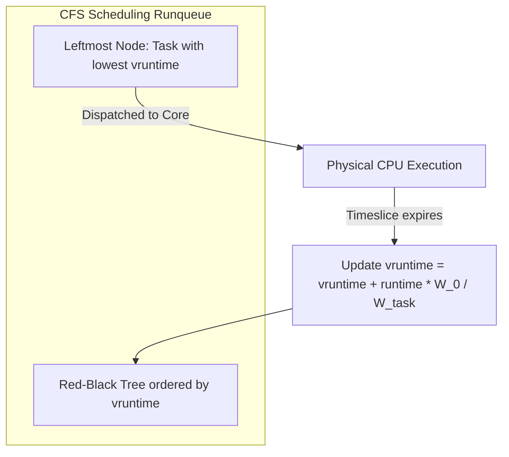

# Linux Completely Fair Scheduler (CFS) & Cgroup Throttling

CFS tracks task execution using virtual runtime (`vruntime`) normalized by task priority weights, ensuring proportional CPU allocation across threads organized into control groups.

---

## 1. Cgroup Bandwidth Control Parameters

* `cpu.cfs_quota_us`: Total allotted CPU execution time in microseconds permitted per period.
* `cpu.cfs_period_us`: Sampling window duration (standard default: 100,000 µs = 100 ms).
* `cpu.stat`: Exposes `nr_periods`, `nr_throttled`, and cumulative `throttled_time` in nanoseconds.
