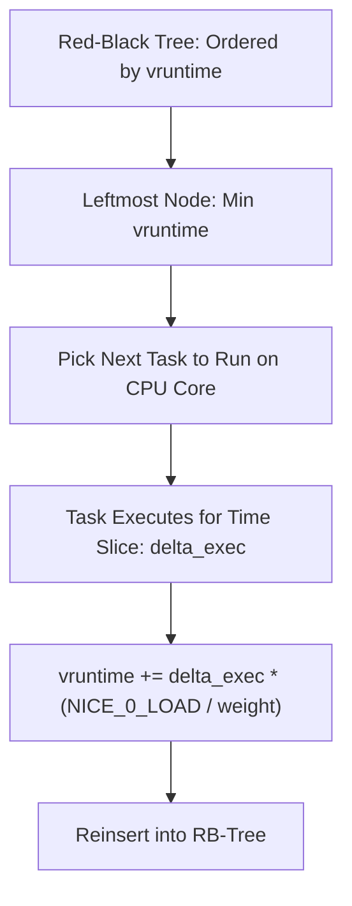

# Linux Kernel: CFS Scheduler vruntime and Latency Targets

The Completely Fair Scheduler (CFS) models an ideal multi-tasking CPU on real hardware using a red-black tree keyed by `vruntime` (virtual runtime).

---

## 1. Nice Values and Weight
A higher nice value (lower priority) gives lower weight, meaning `vruntime` increases faster, causing the task to get less total CPU time.
