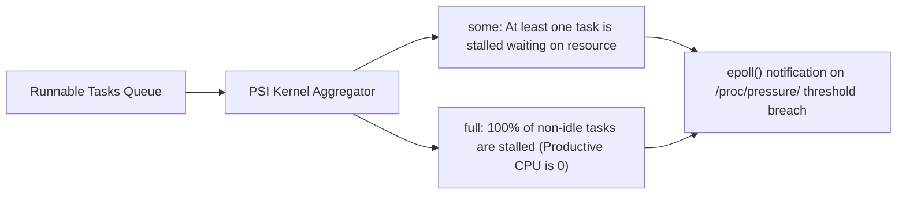

# Linux: Pressure Stall Information (PSI) Metrics

Pressure Stall Information (PSI) quantifies resource saturation across CPU, Memory, and I/O by tracking the exact duration tasks spend waiting for hardware access.

---

## 1. Metrics Breakdown

* **`some` Metric:** Percentage of time during which at least one active task was blocked on resource starvation.
* **`full` Metric:** Percentage of time during which all runnable tasks were stalled simultaneously (complete system throughput loss).
* **Early OOM Handling:** Production Kubernetes clusters monitor `/proc/pressure/memory` to trigger proactive container evictions before kernel hard OOM kills occur.
