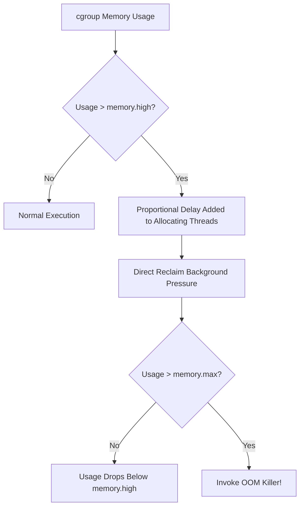

# Linux Resource Isolation: cgroups v2 Memory Pressure Mechanics

cgroups v2 introduces a graduated, non-catastrophic memory pressure model through `memory.high` (soft throttle) versus `memory.max` (hard limit with OOM killer).

---

## 1. Tuning Strategy
- Set `memory.high` at 80-85% of container threshold to trigger aggressive background page reclaim before triggering latency spikes or process termination.
