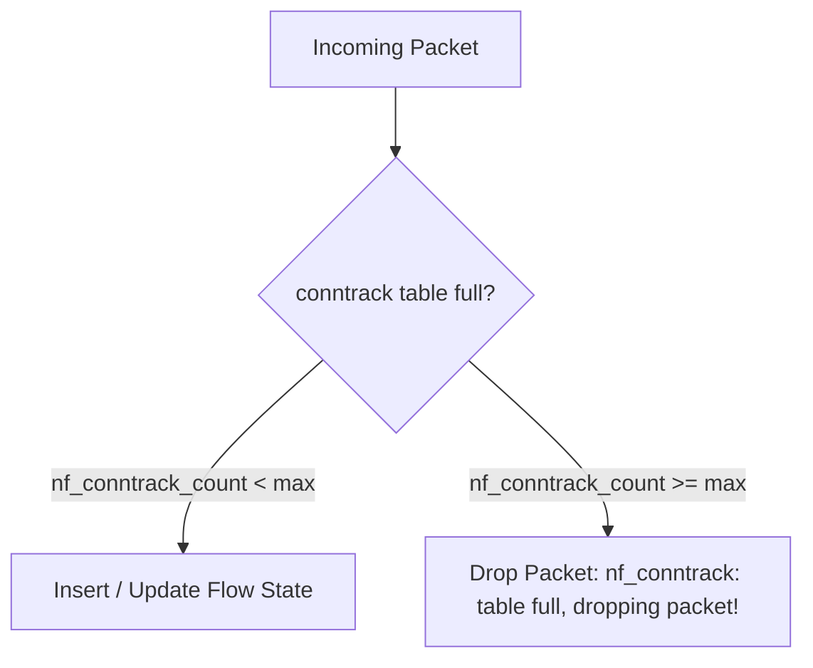

# Linux Security: Netfilter Conntrack Table Sizing & Overflow Protection

Stateful firewalls and Kubernetes NAT (kube-proxy) record every flow in the connection tracking table (`ip_conntrack` / `nf_conntrack`).

---

## 1. Sizing Formula
$$\text{CONNTRACK\_MAX} = \frac{\text{RAM Bytes}}{16384} \times \left(\frac{\text{ARCH}}{32}\right)$$
For high-traffic Kubernetes nodes, bump `net.netfilter.nf_conntrack_max` to 524,288 or 1,048,576.
