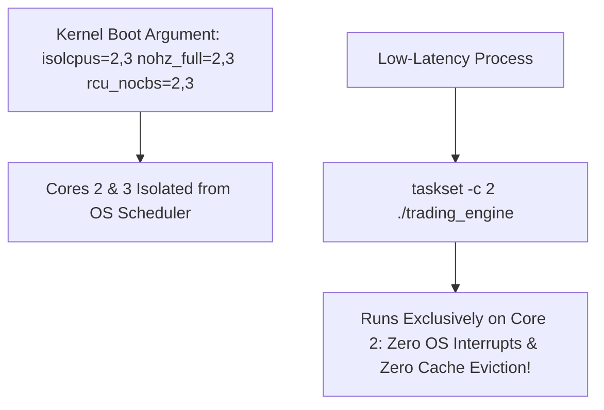

# Kernel Tuning: CPU Affinity and Core Isolation (isolcpus)

Context switches and CPU core migrations invalidate L1/L2 hardware caches, introducing tail-latency spikes in high-frequency trading and low-latency engines.

---

## 1. Companion Flags
- `nohz_full`: Disables scheduling tick on specified cores when only 1 runnable task exists.
- `rcu_nocbs`: Offloads RCU callback processing from isolated cores to housekeeping cores.
