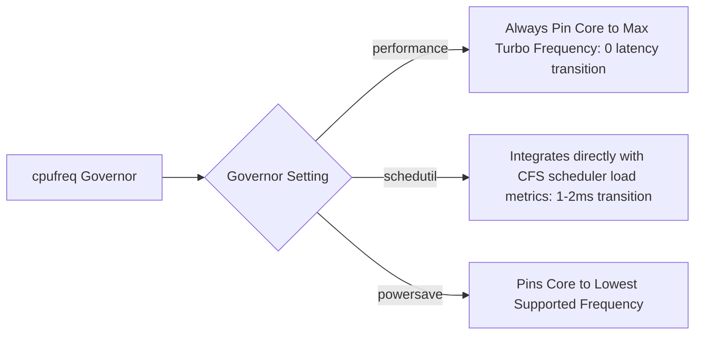

# Linux Power & Latency: CPU Frequency Scaling Governors

CPU frequency governors regulate processor clock speeds and power states based on workload intensity.



---

## 1. Production Recommendation
For ultra-low latency databases and network gateways, set:
```bash
echo performance | tee /sys/devices/system/cpu/cpu*/cpufreq/scaling_governor
```
