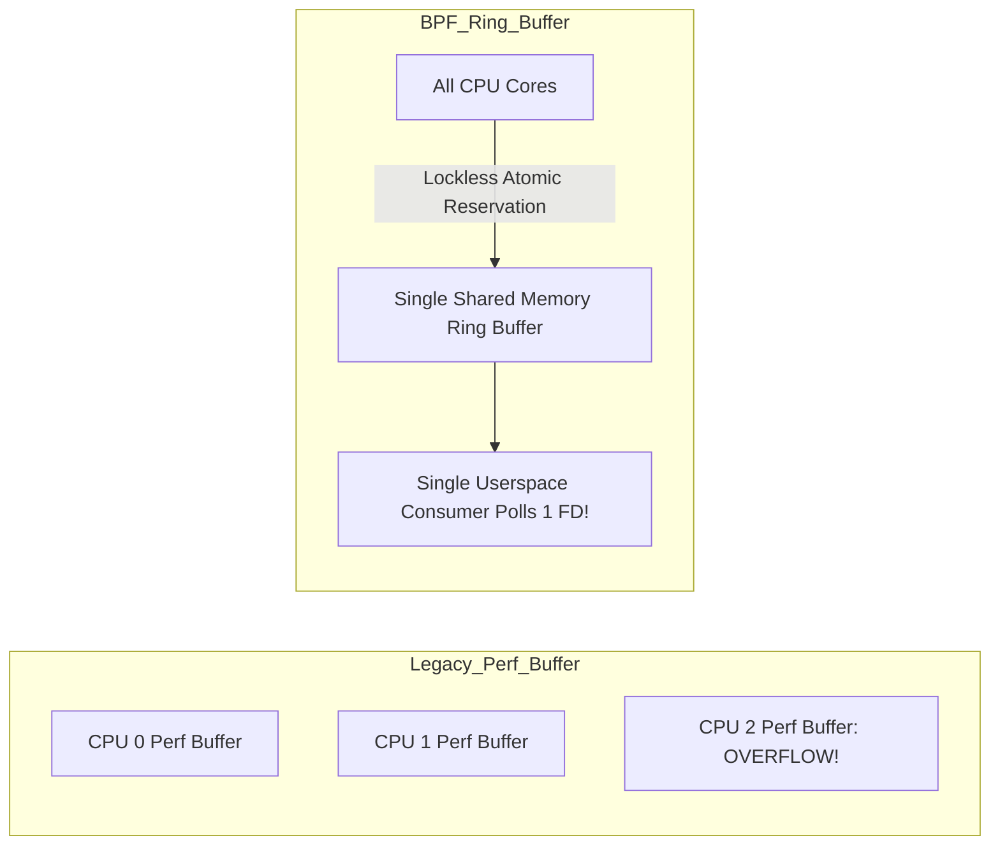

# eBPF Internals: BPF Ring Buffer (bpf_ringbuf) Architecture

The BPF Ring Buffer (`BPF_MAP_TYPE_RINGBUF`) replaces per-CPU perf buffers with a shared multi-producer single-consumer circular buffer.

---

## 1. Advantages of Ringbuf
- **Memory Efficiency:** Eliminates per-CPU sizing imbalances where busy cores drop events while idle cores waste memory.
- **Strict In-Order Event Ordering:** Events across all CPU cores are ordered chronologically by submission time.
