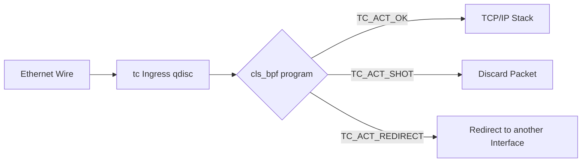

# eBPF Traffic Control (tc / cls_bpf) Architecture

Traffic Control eBPF filters operate on `struct __sk_buff` at both ingress and egress network queuing disciplines (qdisc).

---

## 1. TC vs XDP Comparison

- **XDP**: Executes before `sk_buff` allocation on driver RX path. Faster for raw drop/bounce, but cannot inspect egress traffic or access socket metadata.
- **TC BPF**: Operates on both ingress and egress; access to socket metadata (`skb->sk`), packet cloning, and header expansion.
