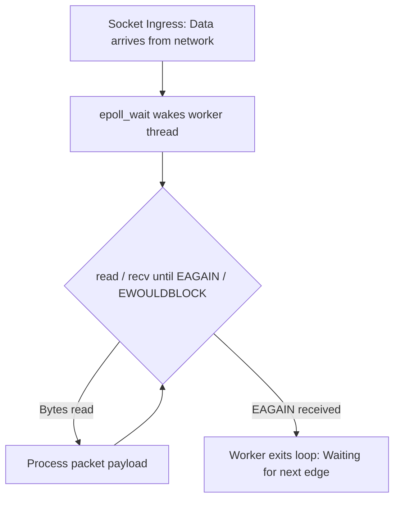

# Linux epoll: Edge-Triggered Mode & Starvation Prevention

Edge-Triggered (`EPOLLET`) epoll minimizes syscall overhead by delivering event notifications only when socket buffer states transition, demanding non-blocking drain loops.

---

## 1. Starvation Mitigations

1. **Worker Starvation:** A high-throughput streaming connection draining endlessly inside a loop can starve other ready file descriptors on the same worker thread.
2. **Quota-Based Looping:** Production event loops (e.g., Tokio, Netty) limit read iterations to a fixed batch size (e.g., 64KB or 16 iterations), re-queuing the connection if unexhausted.
3. **`EPOLLONESHOT`:** Prevents concurrent multi-threaded event deliveries on the same socket across thread pools.
