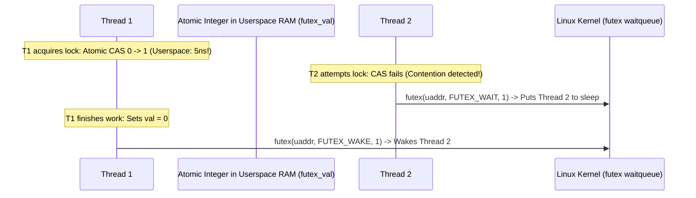

# Concurrency Internals: Linux Futex (Fast Userspace Mutex)

The futex subsystem allows uncontended mutex locking to execute entirely in userspace using atomic operations, invoking kernel system calls only during actual thread contention.

---

## 1. FUTEX_REQUEUE Optimization
When signaling a condition variable where multiple threads wait, `FUTEX_CMP_REQUEUE` moves sleeping threads directly from the condition queue to the mutex queue without waking them up to contend.
