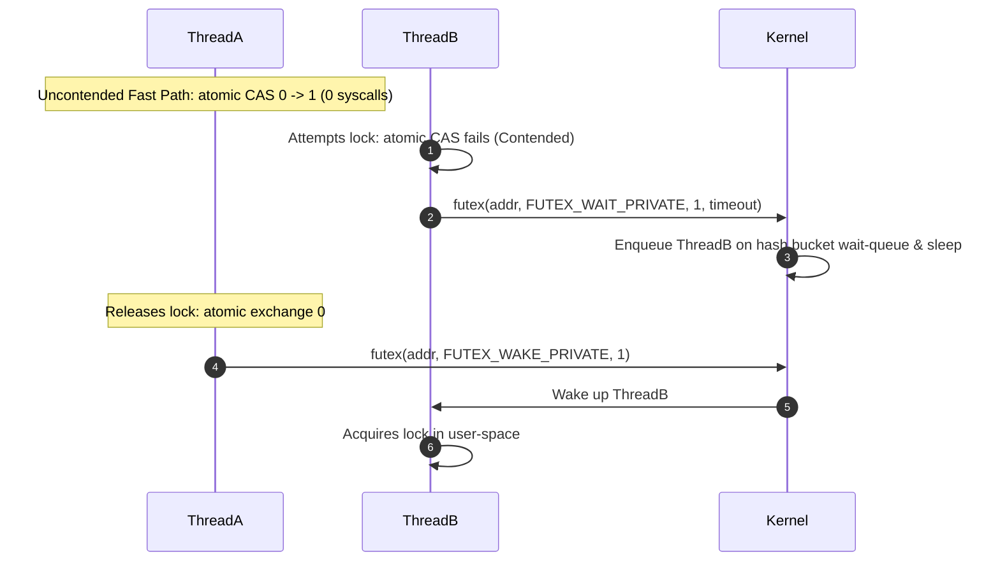

# Linux Fast Userspace Mutex (futex) Architecture

Futexes combine atomic user-space memory operations with kernel wait queues to provide zero-syscall locks under low contention.



---

## 1. Core Syscall Interface

```c
int futex(uint32_t *uaddr, int futex_op, uint32_t val,
          const struct timespec *timeout, uint32_t *uaddr2, uint32_t val3);
```

- `FUTEX_WAIT`: If `*uaddr == val`, puts the calling thread to sleep.
- `FUTEX_WAKE`: Wakes up to `val` threads sleeping on `uaddr`.
- `FUTEX_PRIVATE_FLAG`: Scopes the wait queue to the current process address space, skipping system-wide inode hash locks.
