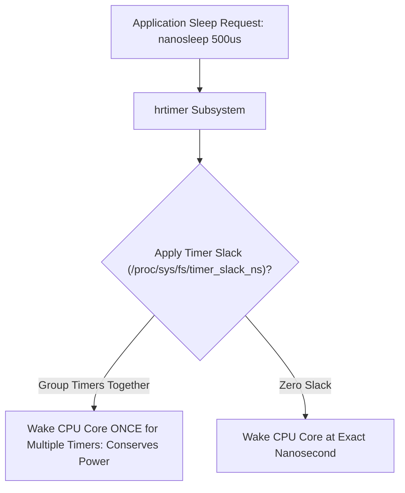

# Linux Kernel: hrtimer Subsystem and Timer Slack Optimization

Legacy kernel timers operate on low-frequency ticks (`CONFIG_HZ` = 250 or 1000). The `hrtimer` subsystem provides nanosecond timer resolution backed by hardware APIC TSC counters.

---

## 1. Latency Sensitive Tuning
For real-time trading or trading gateways, set timer slack to 1ns via `prctl(PR_SET_TIMERSLACK, 1)`.
