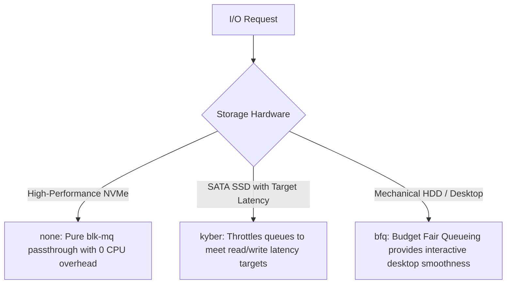

# Linux Block Layer: I/O Schedulers for NVMe vs Mechanical Disks

Legacy I/O schedulers reordered requests to minimize disk head movement. Fast NVMe SSDs perform best with multi-queue schedulers or no scheduler at all.



---

## 1. Production NVMe Best Practice
```bash
echo none | tee /sys/block/nvme*n1/queue/scheduler
```
