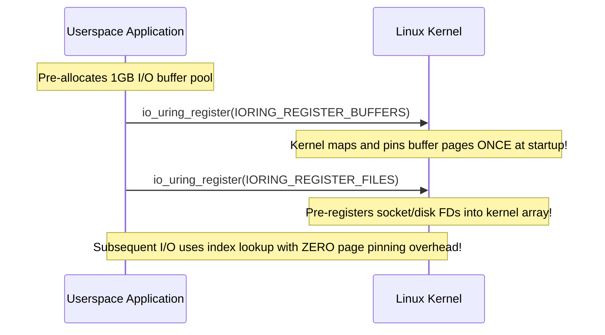

# High-Performance I/O: io_uring Fixed Buffers & Registered Files

Standard I/O requires the kernel to pin and unpin user pages in memory and allocate internal file table structures for every operation. `io_uring` fixed buffers eliminate this overhead.

---

## 1. Performance Impact
Registered buffers increase throughput by 15-20% for high-frequency NVMe storage and 100GbE network packet processing.
