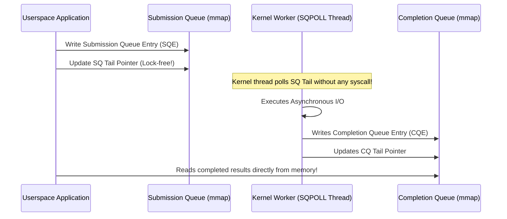

# Linux I/O: io_uring Lock-Free Ring Buffer Architecture

Linux `io_uring` enables zero-syscall asynchronous I/O by sharing two ring buffers (Submission Queue and Completion Queue) in mmap'd memory between user space and kernel space.

---

## 1. SQPOLL Mode
When configured with `IORING_SETUP_SQPOLL`, a dedicated kernel thread polls the submission queue, allowing complete I/O pipelines without executing a single system call.
