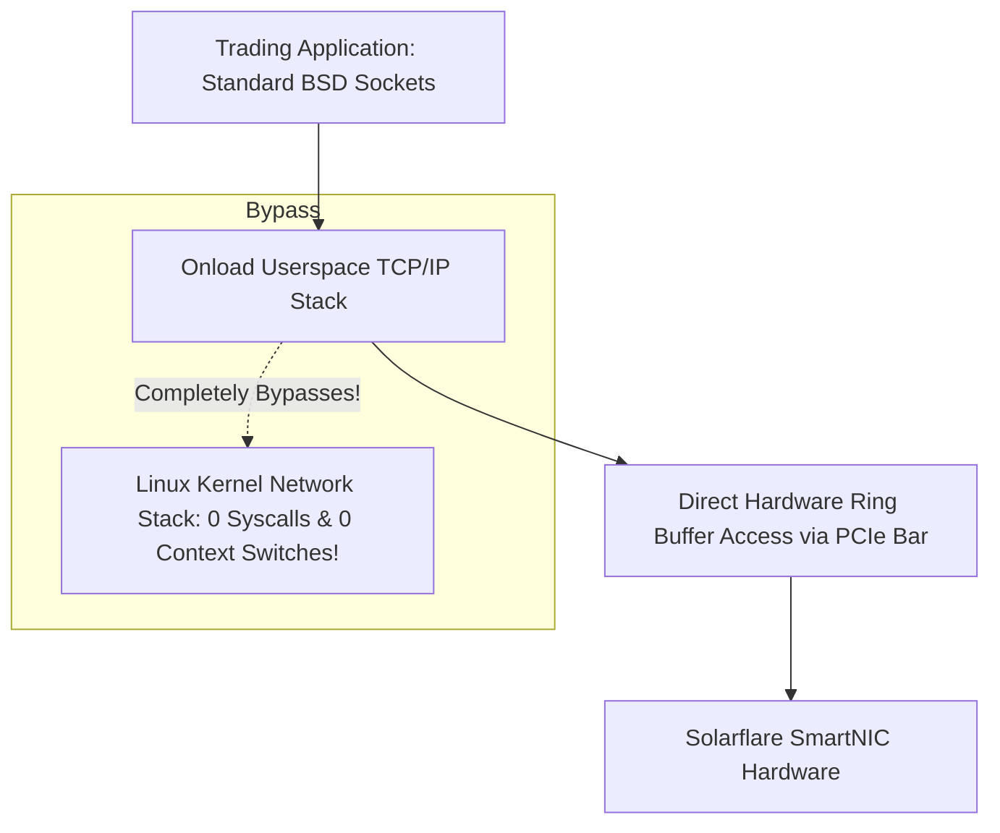

# High-Frequency Trading: OpenOnload User-Level Network Stack

OpenOnload intercepts standard socket calls (`socket`, `read`, `write`) via `LD_PRELOAD` and runs a full TCP/IP stack directly inside userspace application memory.

---

## 1. Latency Profile
Reduces half-round-trip TCP latency from ~4-6 microseconds down to ~700-900 nanoseconds.
