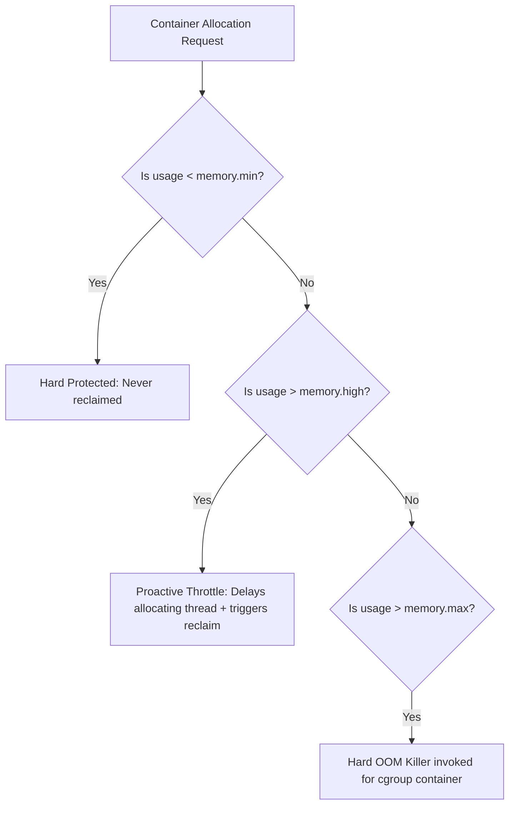

# Linux Containers: cgroups v2 Memory Allocation & Proactive Throttling

The Linux cgroups v2 memory controller replaces legacy hard OOM triggers with multi-tiered pressure thresholds (`memory.min`, `memory.low`, `memory.high`, `memory.max`) to throttle aggressive allocators gracefully.

---

## 1. Controller Levels

* **`memory.min`:** Absolute hard memory protection; pages are never reclaimed under system-wide memory pressure.
* **`memory.low`:** Best-effort protection; reclaimed only if all unprotected memory has been exhausted.
* **`memory.high`:** Soft throttle boundary; container threads are slowed down proportionally to excess memory, giving background flusher threads time to reclaim page cache.
* **`memory.max`:** Hard ceiling; exceeding this limit triggers synchronous direct reclaim or invokes the OOM killer.
